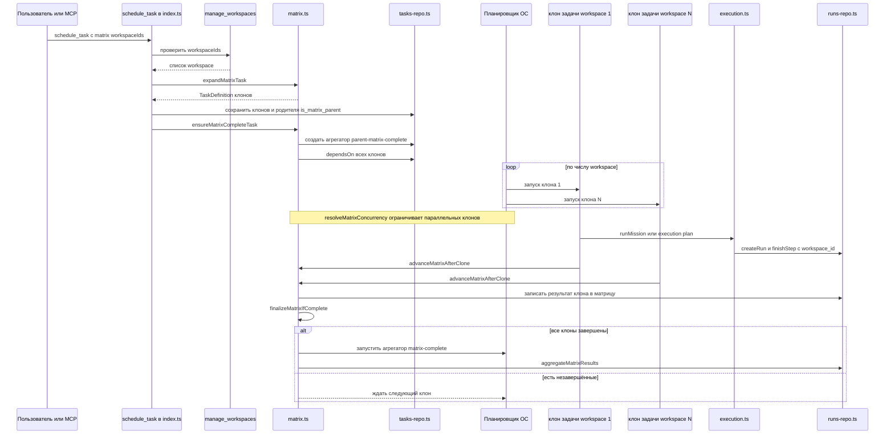
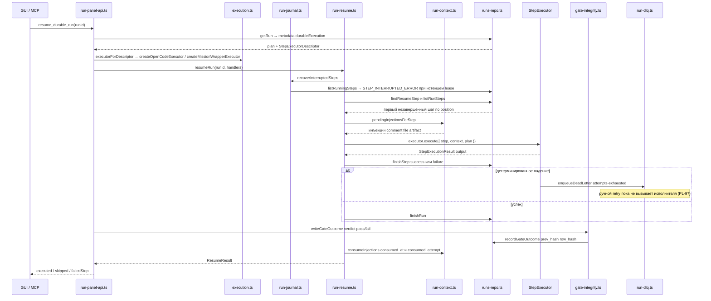

# Steward: Архитектурные диаграммы — последовательности

> Часть основного документа: [ARCHITECTURE-DIAGRAMS.md](./ARCHITECTURE-DIAGRAMS.md).
> Все имена функций сверены с `src/` по состоянию на schema v14, 2026-11-23.

---

## 4. Последовательности

### 4.1 Запуск cron-задачи

Источник: зарегистрированная задача (`registered`), триггер `cron`. Код пути — [record-history.ts](src/core/record-history.ts), [execution.ts](src/core/execution.ts), [runs-repo.ts](src/db/runs-repo.ts).

```mermaid
sequenceDiagram
    participant OS as Планировщик ОС
    participant SCH as scheduler windows или posix
    participant IDX as index.ts (MCP CLI)
    participant RH as record-history.ts
    participant EX as execution.ts
    participant BG as budget.ts
    participant RT as router dispatch и planner
    participant CTX as run-context.ts
    participant AUD as audit.ts
    participant DB as runs-repo.ts
    participant JR as run-journal.ts
    participant OC as opencode-cli.ts
    participant GI as gate-integrity.ts
    participant ESC as router escalation.ts

    OS->>SCH: cron или schtasks /Run
    SCH->>RH: beginRegisteredRun и recordRegisteredRun
    RH->>EX: createRegisteredRunContext
    EX->>EX: validateRunContext
    IDX->>BG: checkBudgetGate → evaluateBudgetGate (до старта, не в execution.ts)
    alt бюджет исчерпан
        BG-->>IDX: skip с причиной
        IDX-->>OS: задача пропущена без запуска агента
    else бюджет есть
        BG-->>IDX: ok
        RH->>EX: buildExecutionPlan
        EX->>RT: planMission и routeStep
        RT->>DB: decideCapabilityRoute читает capability_map
        RT->>CTX: compileContextForRoute → compileRunContext (PL-94)
        note over RT,CTX: buildExecutionPlan сохраняет CompiledContext в шаге; при эскалации run-context.ts рекомпилирует его под новую модель/окно
        RT-->>EX: ExecutionPlan с маршрутами
        EX->>AUD: requestApproval если options.approval и R2 или R3
        alt нет одобрения
            AUD-->>EX: pending или rejected
            EX-->>RH: awaiting_approval или rejected, runId равен null
        else одобрено или R0 R1
            AUD-->>EX: approved
            EX->>DB: createRun и startRun
            loop каждый шаг плана
                EX->>GI: recordEffectIntents до гейта
                EX->>JR: runStepStatefullyAsync
                JR->>OC: StepExecutor execute
                OC-->>JR: output и exitCode
                opt execution.escalation.enabled === true (PL-93)
                    EX->>ESC: runGateWithRetry → resolveGateOutcome → escalateAfterGate
                    ESC-->>EX: verdict local fail → cloud; flake/infra_fail → blocked
                    EX->>DB: recordGateVerdict обучает capability_map и карантин
                end
                JR-->>EX: результат шага
                EX->>EX: writeGateOutcome с финальным verdict (flake/fail — при эскалации)
                EX->>DB: recordGateOutcome с prev_hash и row_hash
                alt вердикт pass
                    EX->>GI: applyDeferredEffects
                    GI-->>EX: EffectSagaResult applied
                else fail
                    EX->>GI: abortDeferredEffects
                end
                EX->>DB: finishStep
            end
            EX->>DB: finishRun
            EX-->>RH: ExecutionResult
        end
    end
```

**Что видно:** единый путь `RunContext → ExecutionPlan → executeExecutionPlan`. Гейт одобрений и бюджет стоят **до** `createRun`; намерения эффектов — **до** гейта; применение эффектов — **только после** `pass`. Эскалация PL-93 показана в блоке `opt`: она вызывается только при явном `execution.escalation.enabled`, по умолчанию путь остаётся прежним. Компиляция контекста PL-94 идёт внутри `buildExecutionPlan`: `CompiledContext` с `contextHash` сохраняется в шаге и передаётся исполнителю, при эскалации пересобирается под новую модель/окно. Очередь одобрений после PL-95 видна пользователю через RPC `list_approvals`/`decide_approval` и карточку GUI, но решение не перезапускает ожидавший запуск автоматически (PL-103).

**Ключевые выводы:** три места, где запуск может быть остановлен без побочных эффектов: budget gate (вызывается в [index.ts](src/index.ts:7948), не в движке), approval gate, worktree snapshot gate (`decideWorktreeSnapshot`/`enforceWorktreeSnapshot`, PL-59). Ledger-запись делает `writeGateOutcome`, а не сам исполнитель — поэтому registered и ad-hoc дают одинаковый набор хэшей. Компиляция контекста PL-94 встроена в план: `compileContextForRoute` создаёт `CompiledContext` с `contextHash`, он доходит до исполнителя и OpenCode-invocation; при эскалации `recompileContextForRouteEscalation` пересобирает контекст под новую модель (`local-7b` → `cloud-large`). flake-aware эскалация PL-93 подключена, но только при `escalation.enabled` (PL-102).

### 4.2 Matrix fan-out

Источник: [matrix.ts](src/core/matrix.ts) (`expandMatrixTask`, `runMatrix`, `resolveMatrixConcurrency`, `advanceMatrixAfterClone`, `finalizeMatrixIfComplete`), конфиг матрицы — `schedule_task({ matrix: {...} })`.



**Что видно:** родительская задача-шаблон сама не исполняется; создаются клоны по workspace и отдельный агрегатор с `dependsOn`. Concurrency ограничивается `resolveMatrixConcurrency`.

**Ключевые выводы:** за завершение матрицы отвечают `advanceMatrixAfterClone` и `finalizeMatrixIfComplete` — именно их следует указывать в схемах и тестах (а не выдуманные `completeMatrix`/`matrixDone`). При `failureMode: stop` незавершённые клоны снимаются через `cancelPendingMatrixClones`.

### 4.3 Resume после краша

Источник: [run-panel-api.ts](src/core/run-panel-api.ts) (`resumeDurableRunExecution`), [execution.ts](src/core/execution.ts) (`durableExecutorDescriptor`, `writeGateOutcome`), [run-resume.ts](src/db/run-resume.ts) (`resumeRun`), [run-journal.ts](src/db/run-journal.ts) (`recoverInterruptedSteps`), [run-dlq.ts](src/db/run-dlq.ts). **PL-92 закрыт:** `resumeRun` подключён к RPC/GUI через фасад, который восстанавливает исполнителя из `metadata.durableExecution`.



**Что видно:** recovery не финализирует шаг с живым lease (`owner_id` + `lease_until`). Возобновление идёт строго по `position` из `findResumeStep`; инъекции на паузе потребляются ровно один раз. Исполнитель поднимается из дескриптора, а вердикт возобновлённого шага пишется в ту же хеш-цепочку `gate_outcomes`.

**Ключевые выводы:** идемпотентность шага держится на `idempotency_key` + `attempt` в `run_steps`, а не на повторном вызове агента вслепую. PL-92 закрыт для RPC/GUI-пути, PL-97 закрыл и ручной retry из DLQ: `retryDlqExecution` после проверки дескриптора вызывает тот же `resumeDurableRunExecution`, поэтому `attempt` растёт один раз, а вердикт падает в ту же цепочку. Без дескриптора запись DLQ остаётся открытой и возвращается диагностика. Функции GATE и отложенные эффекты не сериализуются, поэтому при resume восстанавливается только транспорт + план — это осознанная граница, а не регресс.

---

**Ссылки:** [основной документ](./ARCHITECTURE-DIAGRAMS.md) · [state-диаграммы](./ARCHITECTURE-DIAGRAMS-STATES.md)
