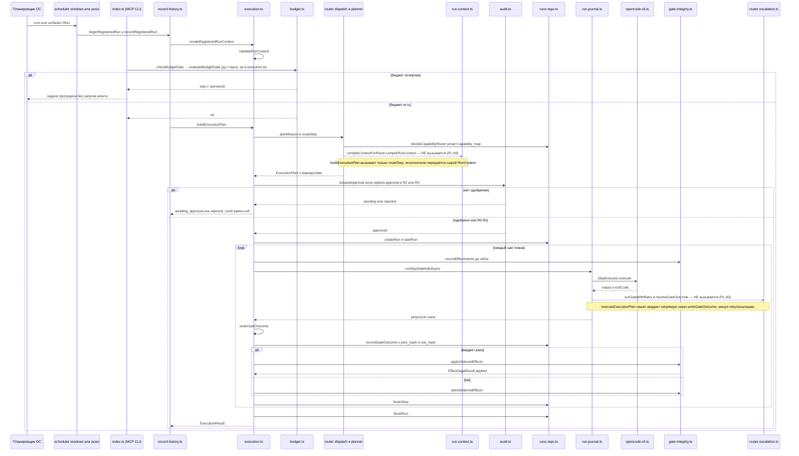
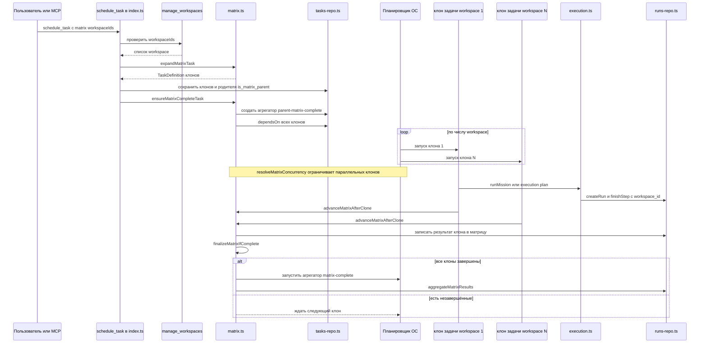
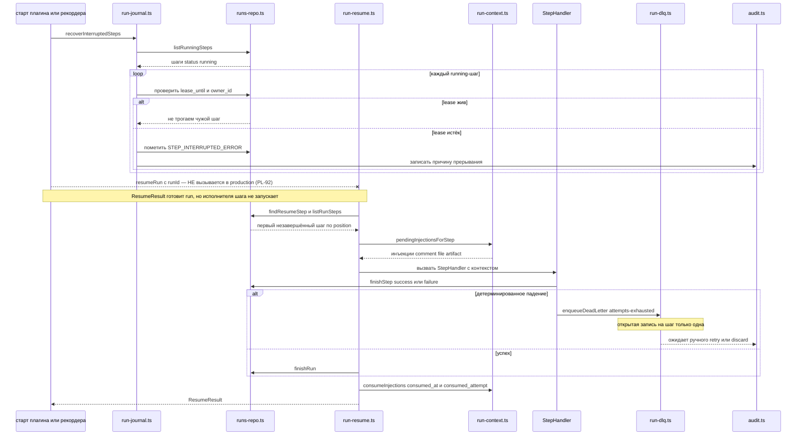

# Steward: Архитектурные диаграммы — последовательности

> Часть основного документа: [ARCHITECTURE-DIAGRAMS.md](./ARCHITECTURE-DIAGRAMS.md).
> Все имена функций сверены с `src/` по состоянию на schema v14, 2026-11-23.

---

## 4. Последовательности

### 4.1 Запуск cron-задачи

Источник: зарегистрированная задача (`registered`), триггер `cron`. Код пути — [record-history.ts](src/core/record-history.ts), [execution.ts](src/core/execution.ts), [runs-repo.ts](src/db/runs-repo.ts).

**Что видно:** единый путь `RunContext → ExecutionPlan → executeExecutionPlan`. Гейт одобрений и бюджет стоят **до** `createRun`; намерения эффектов — **до** гейта; применение эффектов — **только после** `pass`. Стрелки `--x` с пометками PL-94 и PL-93 показывают вызовы, которых в production нет.

**Ключевые выводы:** три места, где запуск может быть остановлен без побочных эффектов: budget gate (вызывается в [index.ts](src/index.ts:7948), не в движке), approval gate, worktree snapshot gate (`decideWorktreeSnapshot`/`enforceWorktreeSnapshot`, PL-59). Ledger-запись делает `writeGateOutcome`, а не сам исполнитель — поэтому registered и ad-hoc дают одинаковый набор хэшей. Компиляция контекста и flake-aware эскалация в этом пути отсутствуют (PL-94, PL-93).

### 4.2 Matrix fan-out

Источник: [matrix.ts](src/core/matrix.ts) (`expandMatrixTask`, `runMatrix`, `resolveMatrixConcurrency`, `advanceMatrixAfterClone`, `finalizeMatrixIfComplete`), конфиг матрицы — `schedule_task({ matrix: {...} })`.

**Что видно:** родительская задача-шаблон сама не исполняется; создаются клоны по workspace и отдельный агрегатор с `dependsOn`. Concurrency ограничивается `resolveMatrixConcurrency`.

**Ключевые выводы:** за завершение матрицы отвечают `advanceMatrixAfterClone` и `finalizeMatrixIfComplete` — именно их следует указывать в схемах и тестах (а не выдуманные `completeMatrix`/`matrixDone`). При `failureMode: stop` незавершённые клоны снимаются через `cancelPendingMatrixClones`.

### 4.3 Resume после краша

Источник: [run-journal.ts](src/db/run-journal.ts) (`recoverInterruptedSteps`), [run-resume.ts](src/db/run-resume.ts) (`findResumeStep`, `resumeRun`), [runs-repo.ts](src/db/runs-repo.ts) (`renewStepLease`), [run-dlq.ts](src/db/run-dlq.ts). **Ниже — целевой поток:** `recoverInterruptedSteps` действительно вызывается при старте, а `resumeRun` в `src/` не вызывается вообще (только в тестах) — см. PL-92.

**Что видно:** recovery не финализирует шаг с живым lease (`owner_id` + `lease_until`). Возобновление идёт строго по `position` из `findResumeStep`; инъекции на паузе потребляются ровно один раз. Стрелка `--x` к `resumeRun` означает, что в текущем production-коде этот вызов отсутствует.

**Ключевые выводы:** идемпотентность шага держится на `idempotency_key` + `attempt` в `run_steps`, а не на повторном вызове агента вслепую. Механизмов два и они не смешиваются: `recoverInterruptedSteps` (массовый при старте, реально работает) и `resumeRun` (точечный по runId — только библиотека и тесты, PL-92). `retryDeadLetter` тоже лишь готовит шаг и ждёт внешний обработчик. DLQ — тупик для детерминированных ошибок, а не общий ретрай.

---

**Ссылки:** [основной документ](./ARCHITECTURE-DIAGRAMS.md) · [state-диаграммы](./ARCHITECTURE-DIAGRAMS-STATES.md)
