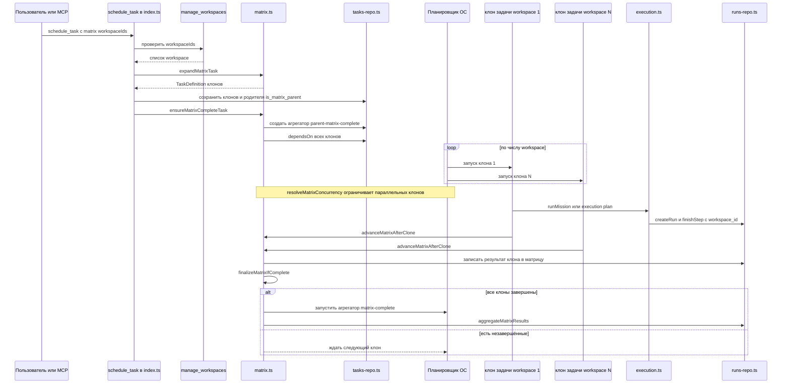
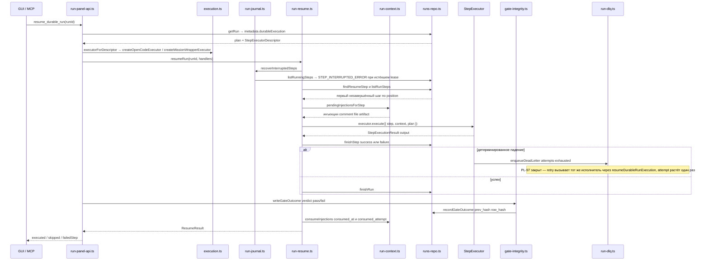

# Steward: Архитектурные диаграммы — последовательности

> Часть основного документа: [ARCHITECTURE-DIAGRAMS.md](./ARCHITECTURE-DIAGRAMS.md).
> Все имена функций сверены с `src/` по состоянию на schema v14, 2026-11-27.

---

## 4. Последовательности

### 4.1a Запуск зарегистрированной задачи (cron/once/file/event)

Источник: зарегистрированная задача (`registered`). Реальный путь: обёртка планировщика ([ps-wrapper.ts](../src/core/ps-wrapper.ts) / [wrappers/bash.ts](../src/core/wrappers/bash.ts)) → `opencode run` → рекордер ([record-history.ts](../src/core/record-history.ts)). Рекордер использует из [execution.ts](../src/core/execution.ts) только контекст-хелперы (`createRegisteredRunContext`, `validateRunContext`, `triggerKindFor`) и `writeGateOutcome`; **`buildExecutionPlan`/`routeStep`/approval/эскалация на этом пути не вызываются** — это осознанная граница (ARCH-1.1).

```mermaid
sequenceDiagram
    participant OS as Планировщик ОС
    participant WR as обёртка ps-wrapper или bash
    participant GI as gate-integrity.ts
    participant RH as record-history.ts
    participant EX as execution.ts (контекст-хелперы)
    participant DB as runs-repo.ts
    participant OC as opencode run (дочерний процесс)

    OS->>WR: cron tick или schtasks /Run
    WR->>WR: schedule gate и PL-106 lock (already running → skip)
    WR->>RH: node record-history.js --budget-gate task (B-1.1/PL-125, до старта PowerShell/opencode)
    opt бюджет исчерпан (exit 3)
        RH->>DB: skipped-запись с причиной, запуск не стартует
    end
    WR->>RH: node record-history.js --start task startedAt
    RH->>DB: history-запись running (startRun)
    RH->>EX: buildRegisteredContext → createRegisteredRunContext + validateRunContext
    RH->>DB: beginRegisteredRun → createRun status running, шаг running, metadata.origin=registered (ARCH-1.1)
    WR->>GI: gate snapshot входов (G-1.2) и worktree-snapshot (PL-25, PL-105)
    WR->>OC: opencode run --model prompt (AGENT_STEWARD_CHILD_RUN=1, QV-8)
    OC-->>WR: exitCode и лог задачи
    WR->>GI: verify входов гейта и worktree-verify перед qualityGate
    alt snapshot mismatch
        GI-->>WR: fail-closed — гейт пропущен, запуск помечен ошибкой
    else целостность подтверждена
        WR->>WR: qualityGate выполняется обёрткой вне агента; PL-81 фиксирует расхождение exitCode и гейта
    end
    WR->>RH: node record-history.js --finish runId task status duration error tokens cost model ...
    RH->>RH: parseUsageFromLog → resolveUsageFromOpenCodeDb → resolveUsageWithOfflineFallback (T-6)
    RH->>DB: finishRun history-записи
    RH->>EX: buildRegisteredContext
    RH->>DB: recordRegisteredRun → finishStep passed/failed/skipped
    RH->>EX: writeGateOutcome verdict pass/fail, evidencePath=лог задачи
    EX->>DB: recordGateOutcome с prev_hash и row_hash
    RH->>DB: finishDurableRun passed/failed/cancelled
```

**Что видно:** один агент-процесс на задачу, quality gate — отдельная команда обёртки, а не шаг execution-loop. Durable-run создаётся тем же `createRun`, что и ad-hoc путь (ARCH-1.1), шаг сразу в `running` (STEP_TRANSITIONS не разрешает `pending → passed`), вердикт пишется в ту же хеш-цепочку `gate_outcomes` через `writeGateOutcome`. Все вызовы durable-слоя в рекордере защищены try/catch: отказ durable-слоя не ломает историю/цепочки/уведомления. Телеметрия: лог → OpenCode DB → offline-оценка `estimateRunUsage` для free-tier моделей с нулевым usage (T-6, событие `usage.offline_estimate`).

**Ключевые выводы:** на этом пути budget gate тоже работает: обёртка `.cmd` до старта PowerShell/opencode вызывает `record-history.js --budget-gate` (`evaluateRunBudgetGate`), при exit 3 запуск не стартует и в историю пишется `skipped` с причиной (B-1.1/B-1.2, **PL-125 закрыт**). Ad-hoc-входы `index.ts` (`run_task_now`, `run_mission`, `runTaskEntry`) используют тот же общий гейт через `checkBudgetGate`. Остановки без побочных эффектов: budget gate, schedule gate/lock обёртки и worktree snapshot gate (`decideWorktreeSnapshot`/`enforceWorktreeSnapshot`, PL-59). Approval gate и эскалация доступны только ad-hoc пути (4.1b). Legacy-вызов рекордера без `--start` тоже идёт через durable-мост (`recordRegisteredRun` создаёт run сам).

### 4.1b Ad-hoc миссия (execution plan)

Источник: `run_mission`/execution plan в [index.ts](../src/index.ts) → [execution.ts](../src/core/execution.ts) (`buildExecutionPlan`, `executeExecutionPlan`, `runMission`). Именно здесь живут маршрутизация, одобрения и эскалация.

```mermaid
sequenceDiagram
    participant U as Пользователь или MCP
    participant IDX as index.ts (run_mission)
    participant BG as budget.ts
    participant EX as execution.ts
    participant RT as router dispatch и planner
    participant CTX as run-context.ts
    participant AUD as audit.ts
    participant DB as runs-repo.ts
    participant JR as run-journal.ts
    participant OC as StepExecutor (opencode-cli.ts)
    participant GI as gate-integrity.ts
    participant ESC as router escalation.ts

    U->>IDX: run_mission или execution plan
    IDX->>BG: checkBudgetGate → evaluateBudgetGate (до старта, не в execution.ts)
    alt бюджет исчерпан
        BG-->>IDX: skip с причиной
        IDX-->>U: задача пропущена без запуска агента
    else бюджет есть
        BG-->>IDX: ok
        IDX->>EX: buildExecutionPlan
        EX->>RT: planMission и routeStep
        RT->>DB: decideCapabilityRoute читает capability_map
        RT->>CTX: compileContextForRoute → compileRunContext (PL-94)
        note over RT,CTX: buildExecutionPlan сохраняет CompiledContext в шаге; при эскалации run-context.ts рекомпилирует его под новую модель/окно
        RT-->>EX: ExecutionPlan с маршрутами
        EX->>AUD: requestApproval если options.approval и R2 или R3
        alt нет одобрения
            AUD-->>EX: pending или rejected
            EX-->>IDX: awaiting_approval или rejected, runId равен null
        else одобрено или R0 R1
            AUD-->>EX: approved
            EX->>DB: createRun и startRun
            loop каждый шаг плана
                EX->>GI: recordEffectIntents до гейта
                EX->>JR: runStepStatefullyAsync
                JR->>OC: StepExecutor execute
                OC-->>JR: output и exitCode
                opt по умолчанию в runMission (PL-93, PL-102); в ядре — при escalation.enabled
                    EX->>EX: agentResultGate — ошибка или ненулевой код шага = fail
                    EX->>ESC: runGateWithRetry → resolveGateOutcome → escalateAfterGate
                    ESC-->>EX: verdict local fail → cloud; flake/infra_fail → blocked
                    EX->>DB: recordGateVerdict обучает capability_map и карантин
                    note over EX,ESC: PL-102: тот же StepExecutor.id на новом маршруте — эскалация не дублирует агента, возвращается причина гейта
                end
                JR-->>EX: результат шага
                EX->>EX: writeGateOutcome с финальным verdict (flake/fail — при эскалации)
                EX->>DB: recordGateOutcome с prev_hash и row_hash
                alt вердикт pass
                    EX->>GI: applyDeferredEffects
                    GI-->>EX: EffectSagaResult applied
                else fail
                    EX->>GI: abortDeferredEffects
                end
                EX->>DB: finishStep
            end
            EX->>DB: finishRun
            EX-->>IDX: ExecutionResult
        end
    end
```

**Что видно:** единый путь `RunContext → ExecutionPlan → executeExecutionPlan`. Гейт одобрений и бюджет стоят **до** `createRun`; намерения эффектов — **до** гейта; применение эффектов — **только после** `pass`. Эскалация PL-93 показана в блоке `opt`: в ядре она требует явного `execution.escalation.enabled`, но реальный `runMission` после PL-102 включает её и передаёт `agentResultGate`; повтор того же исполнителя под другим маршрутом запрещён. Компиляция контекста PL-94 идёт внутри `buildExecutionPlan`: `CompiledContext` с `contextHash` сохраняется в шаге и передаётся исполнителю, при эскалации пересобирается под новую модель/окно. Очередь одобрений после PL-95 видна пользователю через RPC `list_approvals`/`decide_approval` и карточку GUI, а после PL-103 approve автоматически перезапускает отложенный план: дескриптор хранится в аудите, `executeApprovedPlan` помечает решение как запущенное до старта и вызывает `executeExecutionPlan`; планы с эффектами переводятся в ручной перезапуск.

**Ключевые выводы:** три места, где запуск может быть остановлен без побочных эффектов: budget gate (в `index.ts` на входах `run_task_now`/`run_mission`/`runTaskEntry` и в обёртке зарегистрированных задач через `--budget-gate`/`evaluateRunBudgetGate`, B-1.1/B-1.2, PL-125 закрыт; не внутри движка `executeExecutionPlan`), approval gate, worktree snapshot gate (PL-59). Ledger-запись делает `writeGateOutcome`, а не сам исполнитель — поэтому registered (4.1a) и ad-hoc (4.1b) дают одинаковый набор хэшей. Компиляция контекста PL-94 встроена в план: `compileContextForRoute` создаёт `CompiledContext` с `contextHash`, он доходит до исполнителя и OpenCode-invocation; при эскалации `recompileContextForRouteEscalation` пересобирает контекст под новую модель (`local-7b` → `cloud-large`). flake-aware эскалация PL-93 подключена: в `runMission` включена по умолчанию через `agentResultGate` (PL-102), при прямом вызове ядра остаётся opt-in; рекордер зарегистрированных задач использует отдельный процесс с командной quality gate и в execution-loop эскалацию не идёт.

### 4.2 Matrix fan-out

Источник: [matrix.ts](../src/core/matrix.ts) (`expandMatrixTask`, `runMatrix`, `resolveMatrixConcurrency`, `advanceMatrixAfterClone`, `finalizeMatrixIfComplete`), конфиг матрицы — `schedule_task({ matrix: {...} })`.



**Что видно:** родительская задача-шаблон сама не исполняется; создаются клоны по workspace и отдельный агрегатор с `dependsOn`. Concurrency ограничивается `resolveMatrixConcurrency`.

**Ключевые выводы:** за завершение матрицы отвечают `advanceMatrixAfterClone` и `finalizeMatrixIfComplete` — именно их следует указывать в схемах и тестах (а не выдуманные `completeMatrix`/`matrixDone`). При `failureMode: stop` незавершённые клоны снимаются через `cancelPendingMatrixClones`.

### 4.3 Resume после краша

Источник: [run-panel-api.ts](../src/core/run-panel-api.ts) (`resumeDurableRunExecution`), [execution.ts](../src/core/execution.ts) (`durableExecutorDescriptor`, `writeGateOutcome`), [run-resume.ts](../src/db/run-resume.ts) (`resumeRun`), [run-journal.ts](../src/db/run-journal.ts) (`recoverInterruptedSteps`), [run-dlq.ts](../src/db/run-dlq.ts). **PL-92 закрыт:** `resumeRun` подключён к RPC/GUI через фасад, который восстанавливает исполнителя из `metadata.durableExecution`.



**Что видно:** recovery не финализирует шаг с живым lease (`owner_id` + `lease_until`). Возобновление идёт строго по `position` из `findResumeStep`; инъекции на паузе потребляются ровно один раз. Исполнитель поднимается из дескриптора, а вердикт возобновлённого шага пишется в ту же хеш-цепочку `gate_outcomes`.

**Ключевые выводы:** идемпотентность шага держится на `idempotency_key` + `attempt` в `run_steps`, а не на повторном вызове агента вслепую. PL-92 закрыт для RPC/GUI-пути, PL-97 закрыл и ручной retry из DLQ: `retryDlqExecution` после проверки дескриптора вызывает тот же `resumeDurableRunExecution`, поэтому `attempt` растёт один раз, а вердикт падает в ту же цепочку. Без дескриптора запись DLQ остаётся открытой и возвращается диагностика. Функции GATE и отложенные эффекты не сериализуются, поэтому при resume восстанавливается только транспорт + план — это осознанная граница, а не регресс.

---

**Ссылки:** [основной документ](./ARCHITECTURE-DIAGRAMS.md) · [state-диаграммы](./ARCHITECTURE-DIAGRAMS-STATES.md)
