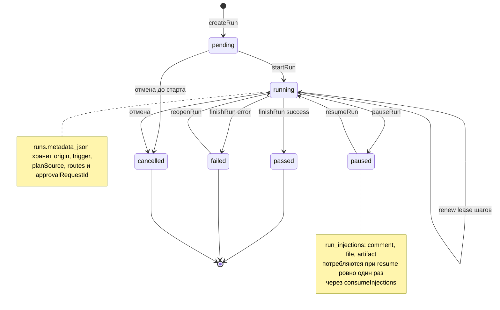
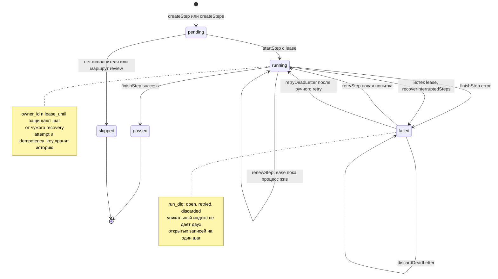

# Steward: Архитектурные диаграммы — состояния

> Часть основного документа: [ARCHITECTURE-DIAGRAMS.md](./ARCHITECTURE-DIAGRAMS.md).
> Типы статусов взяты из [runs-repo.ts](src/db/runs-repo.ts:16): `RunStatus = pending | running | paused | passed | failed | cancelled`, `StepStatus = pending | running | passed | failed | skipped`.

---

## 5. Состояния

### 5.1 Жизненный цикл Run

**Что видно:** у Run шесть статусов. `paused` — не тупик: из него есть возврат в `running` через `resumeRun`. `failed` можно переоткрыть (`reopenRun`), а не только создавать новый run.

**Ключевые выводы:** Run живёт в [runs-repo.ts](src/db/runs-repo.ts): `createRun` (:257), `startRun` (:371), `pauseRunRecord` (:392), `finishRun` (:405), `reopenRun` (:428). Инъекции описаны в [run-context.ts](src/db/run-context.ts) (`pauseRun`, `consumeInjections`), а возврат к шагу — `findResumeStep` в [run-resume.ts](src/db/run-resume.ts:76).

### 5.2 Жизненный цикл Step

**Что видно:** `running` — единственное состояние с само-переходом (`renewStepLease`). Истёкший lease переводит шаг в `failed`, откуда два выхода: `retryStep` (обычный ретрай) или DLQ после исчерпания попыток. Есть и второй вход в `failed`: на старте рекордера `recoverStaleRunningOnRecorderStart` ([record-history.ts](src/core/record-history.ts:121)) закрывает просроченные `running`-записи как `interrupted`, а `markInterruptedRunWithPartialEdits` ([run-journal.ts](src/db/run-journal.ts:357)) помечает durable-run как `failed` с метками `partialWorktreeEdits`/`explicitRetryRequired` — автоповтора нет.

**Ключевые выводы:** `STEP_LEASE_MS = 60_000` ([run-journal.ts](src/db/run-journal.ts:35)) и `STEP_INTERRUPTED_ERROR` ([run-journal.ts](src/db/run-journal.ts:28)) определены в journal. Идемпотентность шага обеспечивают `findStepByIdempotencyKey` и `finishStep` в [runs-repo.ts](src/db/runs-repo.ts), а запись/перезапуск DLQ — `enqueueDeadLetter`/`retryDeadLetter`/`discardDeadLetter` в [run-dlq.ts](src/db/run-dlq.ts). Verdict гейта `flake`/`infra_fail` не меняет статус capability map — см. [capability-repo.ts](src/db/capability-repo.ts:503).

---

**Ссылки:** [основной документ](./ARCHITECTURE-DIAGRAMS.md) · [sequence-диаграммы](./ARCHITECTURE-DIAGRAMS-SEQUENCES.md)
