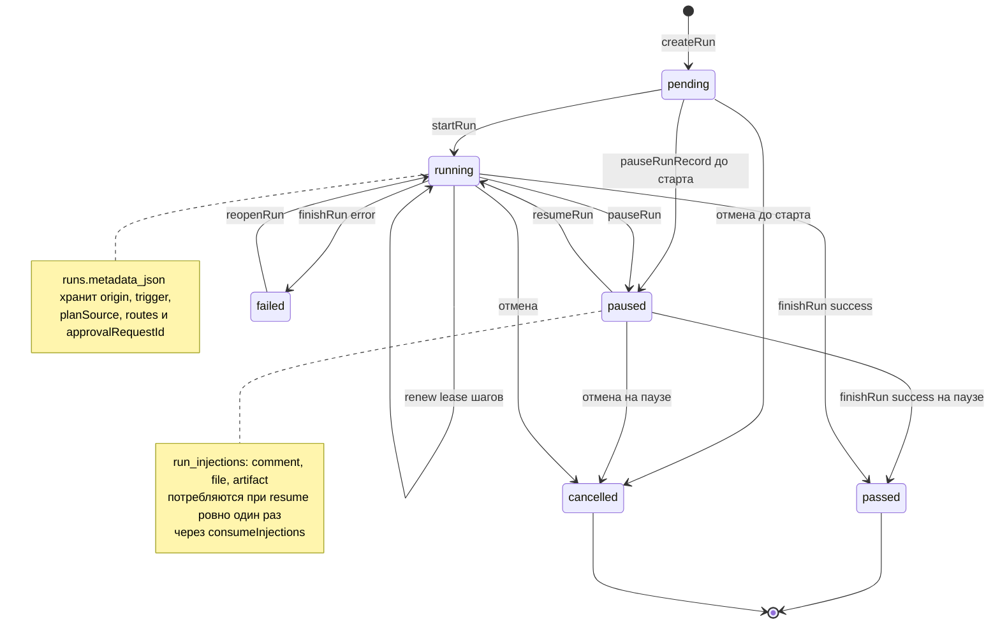
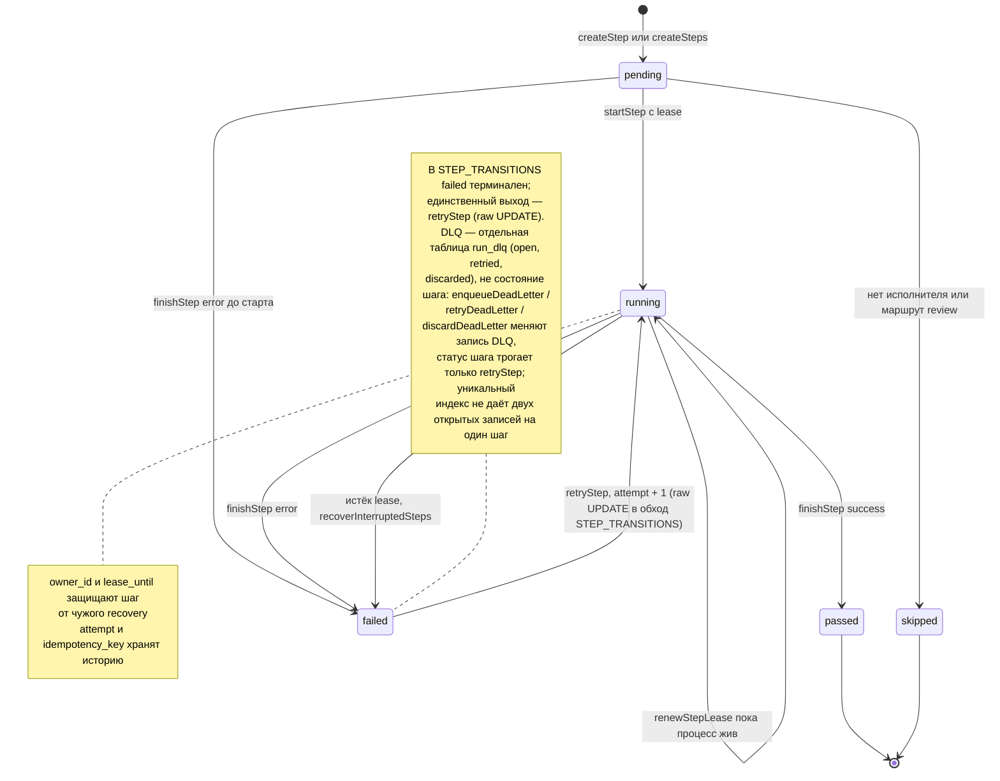

# Steward: Архитектурные диаграммы — состояния

> Часть основного документа: [ARCHITECTURE-DIAGRAMS.md](./ARCHITECTURE-DIAGRAMS.md).
> Типы статусов взяты из [runs-repo.ts](../src/db/runs-repo.ts#L16): `RunStatus = pending | running | paused | passed | failed | cancelled`, `StepStatus = pending | running | passed | failed | skipped`.

---

## 5. Состояния

### 5.1 Жизненный цикл Run

**Что видно:** у Run шесть статусов; переходы один в один повторяют `RUN_TRANSITIONS` ([runs-repo.ts](../src/db/runs-repo.ts)). `paused` — не тупик: из него есть возврат в `running` через `resumeRun`, а также прямые выходы в `passed`/`cancelled` (run можно завершить или отменить, не снимая с паузы); в `paused` можно попасть и из `pending`, до старта. `failed` можно переоткрыть (`reopenRun`), поэтому терминальными являются только `passed` и `cancelled`.

**Ключевые выводы:** Run живёт в [runs-repo.ts](../src/db/runs-repo.ts): `createRun` (:257), `startRun` (:371), `pauseRunRecord` (:392), `finishRun` (:405), `reopenRun` (:428). Инъекции описаны в [run-context.ts](../src/db/run-context.ts) (`pauseRun`, `consumeInjections`), а возврат к шагу — `findResumeStep` в [run-resume.ts](../src/db/run-resume.ts#L76).

### 5.2 Жизненный цикл Step

**Что видно:** `running` — единственное состояние с само-переходом (`renewStepLease`). В `failed` шаг попадает из `running` (ошибка или истёкший lease через `recoverInterruptedSteps`) и из `pending` (`finishStep error` до старта — разрешено `STEP_TRANSITIONS`). Единственный выход из `failed` — `retryStep` с `attempt + 1`; DLQ после исчерпания попыток — это запись в отдельной таблице `run_dlq`, а не переход состояния шага (ручной retry из DLQ доигрывает шаг тем же `retryStep` через `run-journal`/`retryDeadLetter`). Есть и второй вход в `failed` на уровне run: на старте рекордера `recoverStaleRunningOnRecorderStart` ([record-history.ts](../src/core/record-history.ts)) закрывает просроченные `running`-записи как `interrupted`, а `markInterruptedRunWithPartialEdits` ([run-journal.ts](../src/db/run-journal.ts)) помечает durable-run как `failed` с метками `partialWorktreeEdits`/`explicitRetryRequired` — автоповтора нет.

**Расхождение таблицы и кода (осознанное):** `STEP_TRANSITIONS` объявляет `failed` терминальным, но `retryStep` ([runs-repo.ts](../src/db/runs-repo.ts)) делает raw UPDATE `failed → running` с `attempt + 1` в обход `assertTransition` — иначе обычный ретрай и DLQ-retry были бы невозможны. Диаграмма показывает фактическое поведение; таблица описывает только «чистые» переходы `startStep`/`finishStep`.

**Ключевые выводы:** `STEP_LEASE_MS = 60_000` ([run-journal.ts](../src/db/run-journal.ts#L35)) и `STEP_INTERRUPTED_ERROR` ([run-journal.ts](../src/db/run-journal.ts#L28)) определены в journal. Идемпотентность шага обеспечивают `findStepByIdempotencyKey` и `finishStep` в [runs-repo.ts](../src/db/runs-repo.ts), а запись/перезапуск DLQ — `enqueueDeadLetter`/`retryDeadLetter`/`discardDeadLetter` в [run-dlq.ts](../src/db/run-dlq.ts). Verdict гейта `flake`/`infra_fail` не меняет статус capability map — см. [capability-repo.ts](../src/db/capability-repo.ts#L503).

---

**Ссылки:** [основной документ](./ARCHITECTURE-DIAGRAMS.md) · [sequence-диаграммы](./ARCHITECTURE-DIAGRAMS-SEQUENCES.md)
