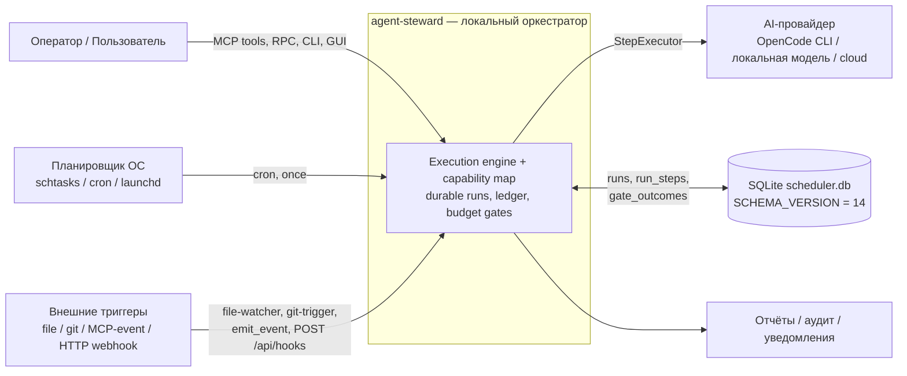
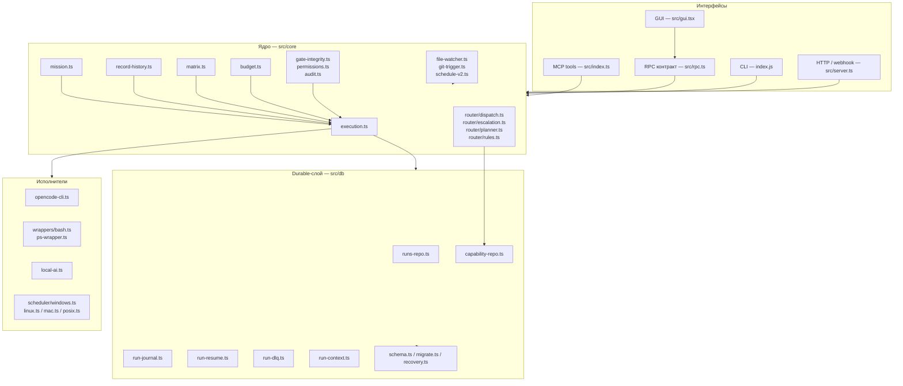
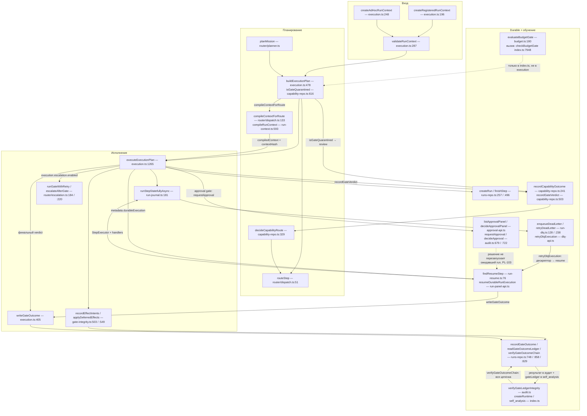
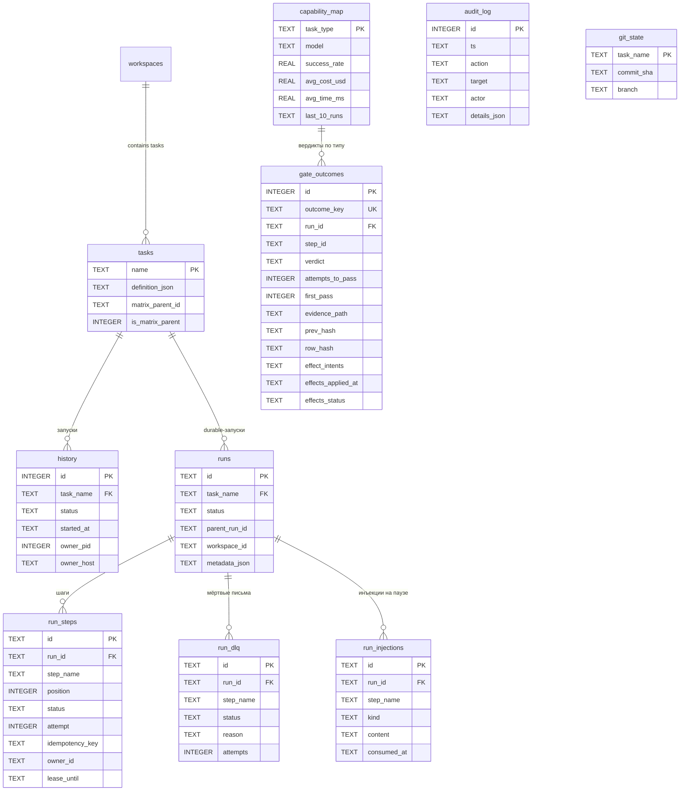

# Steward: Архитектурные диаграммы

> **Статус:** Актуально на schema v14
> **Дата:** 2026-11-23
> **Проверено:** главный агент OpenCode (`opencode/hy4-flash-free`) + сверка по исходникам `src/`; попытка суб-агента завершилась по лимиту Free-модели (см. PL-90 в [ROADMAP.md](../ROADMAP.md))
>
> Все имена файлов и функций в этом документе получены из реального дерева `src/` и подтверждены `Select-String`/`grep`. Там, где однозначного подтверждения нет, стоит пометка `[TODO: проверить]`.

**Содержание:** этот файл — системный контекст, контейнеры, компоненты ядра, модель данных и gap-анализ. Последовательности вынесены в [ARCHITECTURE-DIAGRAMS-SEQUENCES.md](./ARCHITECTURE-DIAGRAMS-SEQUENCES.md), состояния — в [ARCHITECTURE-DIAGRAMS-STATES.md](./ARCHITECTURE-DIAGRAMS-STATES.md).

---

## Реальная структура файлов

Вывод команды `find src/core src/db -type f -name "*.ts" | sort` (на Windows выполнен эквивалент `Get-ChildItem -Recurse -Filter *.ts | Sort-Object`, пути приведены к POSIX-виду):

```text
src/core/analytics.ts
src/core/audit.ts
src/core/budget.ts
src/core/cron-to-schtasks.ts
src/core/dlq-api.ts
src/core/dry-run.ts
src/core/execution.ts
src/core/feedback.ts
src/core/file-watcher.ts
src/core/gate-integrity.ts
src/core/git-trigger.ts
src/core/glob.ts
src/core/guard-run.ts
src/core/guard.ts
src/core/local-ai.ts
src/core/lock.ts
src/core/matrix.ts
src/core/mission.ts
src/core/native-notify.ts
src/core/one-shot.ts
src/core/opencode-cli.ts
src/core/opencode-models.ts
src/core/opencode-usage.ts
src/core/otel.ts
src/core/permissions.ts
src/core/pipeline-apply.ts
src/core/pipeline-io.ts
src/core/pipeline-map.ts
src/core/pipeline-spec.ts
src/core/prometheus.ts
src/core/ps-wrapper.ts
src/core/record-history.ts
src/core/retention.ts
src/core/router/dispatch.ts
src/core/router/escalation.ts
src/core/router/planner.ts
src/core/router/rules.ts
src/core/run-mode.ts
src/core/run-panel-api.ts
src/core/savings.ts
src/core/schedule-gate.ts
src/core/schedule-v2.ts
src/core/scheduler/at-fallback.ts
src/core/scheduler/index.ts
src/core/scheduler/linux.ts
src/core/scheduler/logs.ts
src/core/scheduler/mac.ts
src/core/scheduler/posix.ts
src/core/scheduler/registry.ts
src/core/scheduler/run-now.ts
src/core/scheduler/types.ts
src/core/scheduler/windows.ts
src/core/secrets.ts
src/core/self-analysis.ts
src/core/session.ts
src/core/shutdown.ts
src/core/structured-log.ts
src/core/summary.ts
src/core/task-name.ts
src/core/telegram.ts
src/core/triage-chain.ts
src/core/triage-compare.ts
src/core/triage-rules.ts
src/core/triage-shadow.ts
src/core/triage-worker.ts
src/core/triage.ts
src/core/usage-surface.ts
src/core/watch-paths.ts
src/core/worktree-run.ts
src/core/worktree.ts
src/core/wrappers/bash.ts
src/db/capability-repo.ts
src/db/git-state-repo.ts
src/db/history-repo.ts
src/db/index.ts
src/db/metrics-repo.ts
src/db/migrate.ts
src/db/recovery.ts
src/db/run-context.ts
src/db/run-dlq.ts
src/db/run-journal.ts
src/db/run-resume.ts
src/db/runs-repo.ts
src/db/schema.ts
src/db/settings-repo.ts
src/db/step-idempotency.ts
src/db/tasks-repo.ts
src/db/templates-repo.ts
```

**Что видно:** 71 модуль в `src/core/` (из них 4 — `router/`, 10 — `scheduler/`, 1 — `wrappers/`) и 17 модулей в `src/db/`. Durable-слой вынесен в `src/db/`, оркестрация — в `src/core/`.

**Ключевые выводы:** Принцип «ядро не зависит от транспорта» реализован через [`execution.ts`](src/core/execution.ts): исполнитель (`StepExecutor`) передаётся в `executeExecutionPlan` снаружи. Отдельного `gate-repo.ts` не существует — операции с `gate_outcomes` распределены между [`execution.ts`](src/core/execution.ts), [`runs-repo.ts`](src/db/runs-repo.ts) и [`capability-repo.ts`](src/db/capability-repo.ts).

---

## Проверка ключевых файлов

| Файл | Статус | Комментарий |
|---|---|---|
| [src/core/execution.ts](src/core/execution.ts) | ✅ | Execution engine: `createRegisteredRunContext`, `createAdHocRunContext`, `validateRunContext`, `writeGateOutcome`, `buildExecutionPlan`, `executeExecutionPlan`. Здесь единая точка входа для registered и ad-hoc. |
| [src/core/mission.ts](src/core/mission.ts) | ✅ | Ad-hoc missions: `normalizeMissionSpec`, `createMissionContext`, `runMission`. |
| [src/core/router/dispatch.ts](src/core/router/dispatch.ts) | ✅ | Capability-map routing: `routeStep`, `compileContextForRoute`, `recompileContextForRouteEscalation`. |
| [src/core/router/escalation.ts](src/core/router/escalation.ts) | ✅ | Escalation logic: `gateVerdict`, `runGateWithRetry`, `resolveGateOutcome`, `escalateAfterGate`. |
| [src/core/budget.ts](src/core/budget.ts) | ✅ | Budget gates: `evaluateBudgetGate`, `evaluateTaskTokenBudgetGate`, `buildBudgetReport`. |
| [src/core/gate-integrity.ts](src/core/gate-integrity.ts) | ✅ | Snapshot hash verification: `gateInputsHash`, `createGateSnapshot`, `verifyGateSnapshot`, `verifyWorktreeSnapshot` + saga эффектов. |
| [src/db/runs-repo.ts](src/db/runs-repo.ts) | ✅ | runs/run_steps: `createRun`, `startRun`, `finishStep`, `renewStepLease`; ledger: `recordGateOutcome`, `readGateOutcomeLedger`, `verifyGateOutcomeChain`. |
| [src/db/run-journal.ts](src/db/run-journal.ts) | ✅ | Step journal: `beginStepAttempt`, `renewStepLease`, `recordStepSuccess`, `runStepStatefullyAsync`, `recoverInterruptedSteps`. |
| [src/db/run-resume.ts](src/db/run-resume.ts) | ✅ | Resume after crash: `findResumeStep`, `resumeRunSync`, `resumeRun`. |
| [src/db/run-dlq.ts](src/db/run-dlq.ts) | ✅ | Dead letter queue: `enqueueDeadLetter`, `scanDeadLetters`, `retryDeadLetter`, `discardDeadLetter`. |
| [src/db/capability-repo.ts](src/db/capability-repo.ts) | ✅ | Capability map: `recordCapabilityOutcome`, `decideCapabilityRoute`, `recordGateVerdict`, `isGateQuarantined`. |
| src/db/gate-repo.ts | ❌ | **Не существует.** Функции для `gate_outcomes`: запись вердикта — `writeGateOutcome` ([execution.ts](src/core/execution.ts:405)) и `recordGateOutcome` ([runs-repo.ts](src/db/runs-repo.ts:748)); чтение ledger — `readGateOutcomeLedger` ([runs-repo.ts](src/db/runs-repo.ts:858)); проверка цепочки — `verifyGateOutcomeChain` (там же, :829); обучение карты — `recordGateVerdict` ([capability-repo.ts](src/db/capability-repo.ts:503)). |

**Что видно:** 11 из 12 ожидаемых файлов существуют. Единственное расхождение с исходной гипотезой — `gate-repo.ts`.

**Ключевые выводы:** «Запись вердикта гейта» — это **два** разных уровня: `writeGateOutcome` (единая точка записи из execution loop и рекордера, обогащает хэшами контекста) и `recordGateOutcome` (низкоуровневая вставка в SQLite с хеш-цепочкой). `recordGateVerdict` в `capability-repo.ts` пишет ledger **и** решает, обновлять ли capability map (только стабильные `pass`/`fail`). Матричные операции — `advanceMatrixAfterClone` и `finalizeMatrixIfComplete` — живут в [matrix.ts](src/core/matrix.ts) (:515 и :959).

---

## Диаграммы

### 1. Системный контекст (C4 Level 1)



**Что видно:** система — локальный оркестратор. Четыре класса внешних входов: пользователь (MCP/RPC/CLI/GUI), планировщик ОС, триггеры событий и AI-провайдер как исполняющая сторона. Единственное хранилище — SQLite.

**Ключевые выводы:** планировщик ОС — лишь одна из полос (cron/once), а не центральный маршрут: ядро само выполняет цепочки, DAG, ретраи и матрицы. Webhook-триггер реален (`POST /api/hooks/:task` в [server.ts](src/server.ts), проверка в [integrations.ts](src/integrations.ts)), но отсутствует в типе `RunTrigger` ([execution.ts](src/core/execution.ts:65)) — см. gap-анализ.

### 2. Контейнеры (C4 Level 2)



**Что видно:** интерфейсы (MCP/RPC/CLI/HTTP/GUI) не содержат бизнес-логики — они тонкие адаптеры над ядром. Durable-слой отделён от ядра и от исполнителей.

**Ключевые выводы:** замена транспорта (OpenCode → shell → локальная модель) не требует правок `execution.ts`: интерфейс `StepExecutor` объявлен в [execution.ts](src/core/execution.ts:533), а конкретная реализация `createOpenCodeExecutor` — там же (:550). GUI общается с ядром только через [rpc.ts](src/rpc.ts).

### 3. Компоненты ядра



**Условные обозначения:** сплошная стрелка — реальный вызов в `src/`; пунктирные стрелки означают не «неподключённый модуль», а границу ответственности: `BUDGET -.-> BP` — бюджет проверяется в `index.ts`, а не внутри `execution.ts`; `APPR -.-> RESUME` — одобрение через RPC/GUI фиксируется в журнале аудита, но ожидавший запуск не перезапускается автоматически (PL-103). PL-93, PL-94, PL-97 и PL-98 переведены на сплошные стрелки.

**Что видно:** после PL-93 ядро замыкает «исполнение → ledger → обучение карты → роутинг»: `executeExecutionPlan` при `execution.escalation.enabled` вызывает `runGateWithRetry`/`escalateAfterGate`, пишет вердикт через `writeGateOutcome` и обучает capability map через `recordGateVerdict`; `buildExecutionPlan` проверяет `isGateQuarantined` и уводит шаг в `review`. После PL-94 план дополнительно несёт `CompiledContext`: `compileContextForRoute` собирает его из ledger, `contextHash` передаётся исполнителю, а при эскалации контекст пересобирается под новую модель/окно. После PL-92 добавлен и путь «metadata.durableExecution → resume → тот же journal/ledger». После PL-95 в контур появился фасад `approval-api.ts`: гейт high-risk вызывает `requestApproval`, а список и решения одобрений доступны через RPC `list_approvals`/`decide_approval` и карточку GUI (журнал аудита, без новой таблицы). После PL-97 DLQ-очередь тоже подключена к исполнению: `retryDlqExecution` проверяет дескриптор, закрывает запись и сразу вызывает `resumeDurableRunExecution`. После PL-98 цепочка `gate_outcomes` проверяется автоматически при старте (`createRuntime`) и при каждом запросе самоанализа: результат пишется в `audit_log` действием `gate_ledger.verify` и попадает в поле `gateLedger` отчёта.

**Ключевые выводы:** `writeGateOutcome` ([execution.ts](src/core/execution.ts:405)) — единственная точка записи вердикта в ledger, а при включённой эскалации рядом вызывается и `recordGateVerdict` ([capability-repo.ts](src/db/capability-repo.ts:503)). Эскалация **по умолчанию выключена** (`escalation.enabled` должен быть явным), поэтому Python/CLI-вызовы без опции сохраняют старое поведение. Скомпилированный контекст теперь не теряется между планом и исполнителем: `CompiledContext.contextHash` доходит до `StepExecutionInput` и `OpenCodeInvocation`, а при эскалации пересобирается через `recompileContextForRouteEscalation`. Бюджет проверяется до старта задачи в [index.ts](src/index.ts:7948) (`checkBudgetGate`), а не внутри `executeExecutionPlan`. Lease шага (`renewStepLease` в [runs-repo.ts](src/db/runs-repo.ts:553) и [run-journal.ts](src/db/run-journal.ts:119)) — основа safe-resume; PL-92 подключил `resumeRun` к RPC/GUI-пути, а PL-97 — к ручному retry из DLQ. Без дескриптора `durableExecution` DLQ-запись остаётся открытой и возвращается явная диагностика (подготовительный путь `retryDlq` сохранён). Очередь одобрений после PL-95 доступна пользователю, но её решение пока не перезапускает отложенный план (PL-103). Автопроверка PL-98 не ломает старт: `verifyGateLedgerIntegrity` проглатывает ошибки чтения и пишет успешный или повреждённый результат в аудит, а `getLastGateLedgerVerification()` отдаёт результат последней проверки без повторного чтения ledger-а.

### 6. Модель данных (ER-диаграмма)

Реальные таблицы из [schema.ts](src/db/schema.ts) (`SCHEMA_SQL` + `GATE_OUTCOMES_DDL`):



**Что видно:** `runs`/`run_steps` — durable-ядро; `gate_outcomes` — append-only ledger с `prev_hash` → `row_hash`; `capability_map` — агрегат из того же ledger; `run_dlq` и `run_injections` — служебные таблицы для детерминированных падений и паузы.

**Ключевые выводы:** цепочка `prev_hash`/`row_hash` — tamper-evident аудит, а не граница безопасности (прямо указано в комментарии [schema.ts](src/db/schema.ts:14) и §10 `EXECUTION-LOOP.md`). Уникальный индекс `idx_run_dlq_open_unique` гарантирует, что ручной retry не создаст дубль открытой записи. Новые колонки эффектов (`effect_intents`, `effects_applied_at`, …) намеренно **не** входят в `GateOutcomeContent`, чтобы не ломать хеш-цепочку.

---

## 7. Gap-анализ

### Реализовано (подтверждено кодом)

| Возможность | Где | Ключевые символы |
|---|---|---|
| Durable execution | [runs-repo.ts](src/db/runs-repo.ts), [run-journal.ts](src/db/run-journal.ts) | `createRun`, `finishStep`, `renewStepLease`, `runStepStatefullyAsync` |
| Lease + recovery | [run-resume.ts](src/db/run-resume.ts), [run-journal.ts](src/db/run-journal.ts), [record-history.ts](src/core/record-history.ts) | `findResumeStep`, `resumeRun`, `recoverInterruptedSteps`, `recoverStaleRunningOnRecorderStart` (PL-63), `markInterruptedRunWithPartialEdits` |
| Tamper-evident ledger | [runs-repo.ts](src/db/runs-repo.ts) | `recordGateOutcome`, `readGateOutcomeLedger`, `verifyGateOutcomeChain` |
| Capability map (самообучение) | [capability-repo.ts](src/db/capability-repo.ts), [dispatch.ts](src/core/router/dispatch.ts) | `recordCapabilityOutcome`, `decideCapabilityRoute`, `routeStep` |
| Flake-aware verdict + карантин | [escalation.ts](src/core/router/escalation.ts), [capability-repo.ts](src/db/capability-repo.ts) | `runGateWithRetry`, `resolveGateOutcome`, `recordGateVerdict`, `isGateQuarantined` |
| Budget gates (day/week/per-task) | [budget.ts](src/core/budget.ts) | `evaluateBudgetGate`, `evaluateTaskTokenBudgetGate`, `buildBudgetReport` |
| Matrix fan-out + concurrency | [matrix.ts](src/core/matrix.ts) | `expandMatrixTask`, `runMatrix`, `resolveMatrixConcurrency`, `advanceMatrixAfterClone`, `finalizeMatrixIfComplete` |
| DLQ | [run-dlq.ts](src/db/run-dlq.ts) | `enqueueDeadLetter`, `scanDeadLetters`, `retryDeadLetter`, `discardDeadLetter` |
| Pause/resume + инъекции | [run-context.ts](src/db/run-context.ts), [run-resume.ts](src/db/run-resume.ts) | `pauseRun`, `consumeInjections`, `resumeRun` |
| Отложенные эффекты + сага | [gate-integrity.ts](src/core/gate-integrity.ts) | `recordEffectIntents`, `applyDeferredEffects`, `abortDeferredEffects` |
| Snapshot hash verification | [gate-integrity.ts](src/core/gate-integrity.ts) | `gateInputsHash`, `verifyGateSnapshot`, `verifyWorktreeSnapshot` |
| Реальные триггеры | [scheduler/](src/core/scheduler/index.ts), [file-watcher.ts](src/core/file-watcher.ts), [git-trigger.ts](src/core/git-trigger.ts), [server.ts](src/server.ts) | cron/once, `FileWatchManager`, `GitTriggerManager`, `POST /api/hooks/:task`, `emit_event` |
| Реальные исполнители | [opencode-cli.ts](src/core/opencode-cli.ts), [wrappers/bash.ts](src/core/wrappers/bash.ts), [local-ai.ts](src/core/local-ai.ts), [ps-wrapper.ts](src/core/ps-wrapper.ts) | `createOpenCodeExecutor`, shell/locale, локальная модель |
| Реальные интерфейсы | [index.ts](src/index.ts), [rpc.ts](src/rpc.ts), [server.ts](src/server.ts) | MCP tools, `Rpc.define`, HTTP API + GUI |

### Чего не хватает / неоднозначно

1. **`src/db/gate-repo.ts` отсутствует.** Ledger и обучение карты разнесены по трём модулям (`execution.ts`, `runs-repo.ts`, `capability-repo.ts`). Это не баг, но диаграммы, предполагающие наличие `gate-repo.ts`, будут неверны. Зафиксировано в таблице проверки выше.
2. **Webhook-триггер есть на HTTP-уровне, но отсутствует в `RunTrigger`.** В [execution.ts](src/core/execution.ts:65) перечислены `manual | cron | file | git | mcp-event | once`, а `triggerKindFor` (:365) превращает `mcp-event` → `mcp`. Ветка webhook попадает в scheduled run через `server.ts`/`integrations.ts`, но как отдельный `trigger_kind` в ledger не попадает → в отчётах webhook-запуски неотличимы от cron. Зафиксировано как PL-91 в `ROADMAP.md`.
3. **Approval UI/RPC интегрирован (PL-95), но нет автоперезапуска (PL-103).** Фасад [approval-api.ts](src/core/approval-api.ts) открывает очередь через RPC `list_approvals`/`decide_approval` и карточку GUI; решение сохраняется в журнале аудита, но ожидавший high-risk запуск не перезапускается сам (PL-103). Open-задача A-1 §3 тем самым закрыта в части интерфейса.
4. **Docker/SSH runner отсутствует** — открытые задачи D-1/D-2/D-3 (§3 ROADMAP). Исполнители сейчас: OpenCode CLI, shell, локальная модель.
5. **Экономика v2 частична** — `budget.ts` считает day/week/per-task гейты, но E-3 (token efficiency), E-4 (прогноз/Grafana), E-5 (local vs cloud) открыты.
6. **Покрытие Quality Gate неполное** — по PL-65/PL-66 в ROADMAP: часть ARCH-задач не включала затронутые сюиты и `lint`. Обёртка не всегда проверяет SCOPE-пути на существование (PL-79/PL-82).
7. **Суб-агент как механизм выполнения ненадёжен на Free-модели** — при автопроверке документа суб-агент упал с «Free usage limit reached» (аналог PL-72/PL-76). Добавлено как PL-90.
8. **PL-95 закрыт: очередь одобрений доступна через RPC и GUI.** `requestApproval`/`decideApproval`/`listPendingApprovals` в [audit.ts](src/core/audit.ts:679)/:722/:776 остаются источником данных (журнал аудита, без новой таблицы и без смены `SCHEMA_VERSION=14`); фасад [approval-api.ts](src/core/approval-api.ts) добавляет валидацию и ограничение лимита. В [rpc.ts](src/rpc.ts) появились `list_approvals`/`decide_approval` (счётчик 57 → 59), в [index.ts](src/index.ts) — обработчики, в `src/gui.tsx` — карточка «Одобрения» с ключами `gui.approvals*` в трёх локалях. Прежний `[TODO: проверить]` снят: методы существуют и покрыты регрессией в `test-pause-gui.mjs`. Оставшийся нюанс — отсутствие автоматического перезапуска после approve (PL-103).

9. **PL-97 закрыт: DLQ-retry тоже доигрывает шаг.** PL-92 закрыт: `executeExecutionPlan` пишет `metadata.durableExecution`, а `resumeDurableRunExecution` ([run-panel-api.ts](src/core/run-panel-api.ts)) восстанавливает `StepExecutor`, вызывает `resumeRun` и фиксирует вердикт через `writeGateOutcome`. PL-97 добавил `retryDlqExecution` ([dlq-api.ts](src/core/dlq-api.ts)): перед мутациями проверяется дескриптор (`hasDurableExecution`), затем `retryDeadLetter` ([run-dlq.ts](src/db/run-dlq.ts:238)) в режиме `deferStepStart` закрывает запись и переоткрывает run, оставляя шаг `failed` ровно до `beginStepAttempt` — так `attempt` увеличивается один раз за повтор. RPC `retry_dlq` и кнопка GUI идут через исполняющий путь; легаси `retryDlq` остался как подготовительный. Если дескриптора нет, запись остаётся открытой и возвращается диагностика. Транспорт `opencode` по умолчанию теперь поднимается через `invokeOpenCodeCli` (реальный CLI с сохранёнными cwd/моделью/сессией). Регрессия в `test-dlq-gui.mjs`: «DLQ → retry → finishStep», один вызов исполнителя, `attempt 3 → 4`, вердикт в ledger и отказ без дескриптора. Диаграмма 4.3 описывает рабочий поток resume, разделяемый с DLQ.

10. **PL-93 закрыт: эскалация подключена, но opt-in.** [execution.ts](src/core/execution.ts:1265) импортирует `runGateWithRetry`/`escalateAfterGate` ([escalation.ts](src/core/router/escalation.ts:184)/:220) и `isGateQuarantined`/`recordGateVerdict` ([capability-repo.ts](src/db/capability-repo.ts:616)/:503). При `escalation.enabled: true` гейт повторяется до 2 попыток на артефакте, стабильный `fail` local уходит на cloud-исполнителя (если он есть в `executors`), вердикт пишется через `writeGateOutcome`, а через `recordGateVerdict` обновляется capability map и карантин. `buildExecutionPlan` ([execution.ts](src/core/execution.ts:478)) при карантине гейта уводит шаг в `review`. По умолчанию эскалация выключена: production-вызовы без опции ведут себя как раньше (PL-99 — включить её в реальном mission/index-пути и передать функцию гейта).

11. **PL-94 закрыт: контекст компилируется из ledger и доходит до исполнителя.** `buildExecutionPlan` ([execution.ts](src/core/execution.ts:478)) после `routeStep` вызывает `compileContextForRoute` ([dispatch.ts](src/core/router/dispatch.ts:133)) и сохраняет `CompiledContext` (`compiledFrom: "ledger"`, SHA-256 `contextHash`, модель `local-7b`/`cloud-large`) в `PlannedStep.compiledContext`. Поле передаётся в `StepExecutionInput` и `OpenCodeInvocation`, а при PL-93-эскалации `executeStepWithEscalation` пересобирает контекст через `recompileContextForRouteEscalation`/`recompileContextOnEscalation` ([run-context.ts](src/db/run-context.ts:814)) под новую модель и окно. Регрессия в `test-execution-pipeline.mjs` проверяет 12 свойств, включая разные `contextHash` для local и cloud. Полный контур «committed + execution.escalation.enabled» в реальных вызовах остаётся за PL-102.

12. **PL-96 и PL-98 закрыты: цепочка проверяется полностью и автоматически.** `verifyGateOutcomeChain()` ([runs-repo.ts](src/db/runs-repo.ts:837)) без аргументов читает все строки через `listAllGateOutcomes()` (:827); `readGateOutcomeLedger()` (:869) тоже проверяет полную цепочку при `verify !== false`, хотя возвращает `rows` с заданным `limit`. PL-98 добавил фасад `verifyGateLedgerIntegrity(source)` ([audit.ts](src/core/audit.ts)): он вызывает полную проверку, пишет действие `gate_ledger.verify` в `audit_log` (источник, `ok`, `length`, `brokenAt`, `reason`, `checkedAt`) и кэширует результат для `getLastGateLedgerVerification()`. Вызовы встроены в `createRuntime` ([index.ts](src/index.ts)) при старте и в оба пути `self_analysis` (MCP-инструмент и RPC): отчёт дополнился полем `gateLedger`. Ошибки проглатываются, старт и отчёт не ломаются. Регрессия в `test-capability-map.mjs`: валидная цепочка из 5 записей, подмена `evidence_path` последней, разрыв `brokenAt=4`, две записи в аудите и свежий кэш.

> **Важно для читателя:** пункты 3 и 8 описывают один и тот же закрытый контур одобрений (PL-95) с оставшимся нюансом PL-103; пункт 12 описывает закрытую автопроверку цепочки ledger (PL-98). Resume (п. 9) подключён и к RPC/GUI, и к DLQ-retry. Эскалация (п. 10) встроена, но требует явного `escalation.enabled`; компиляция контекста (п. 11) встроена в `buildExecutionPlan` по умолчанию. Диаграммы 3 и 4.1 показывают фактические вызовы сплошной линией, а неподключённые связи — пунктиром.

### Ссылки на смежные документы

- [ARCHITECTURE.md](./ARCHITECTURE.md) — общее устройство и счётчики.
- [EXECUTION-LOOP.md](./EXECUTION-LOOP.md) — целевой кровоток, §3 (схема `gate_outcomes`) и §10 (hash-ledger как аудит).
- [ARCHITECTURE-DIAGRAMS-SEQUENCES.md](./ARCHITECTURE-DIAGRAMS-SEQUENCES.md) — sequence-диаграммы.
- [ARCHITECTURE-DIAGRAMS-STATES.md](./ARCHITECTURE-DIAGRAMS-STATES.md) — state-диаграммы.
- [ROADMAP.md](../ROADMAP.md), [CHANGELOG.md](../CHANGELOG.md).
